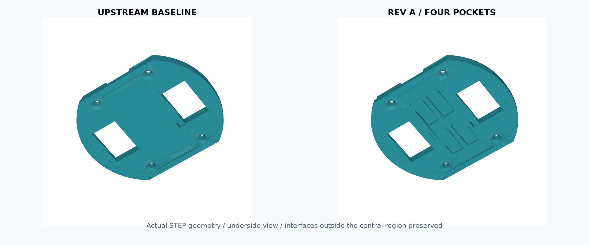
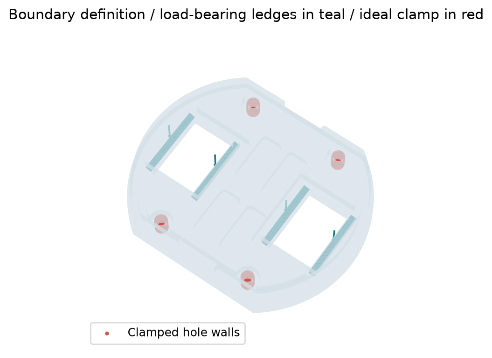
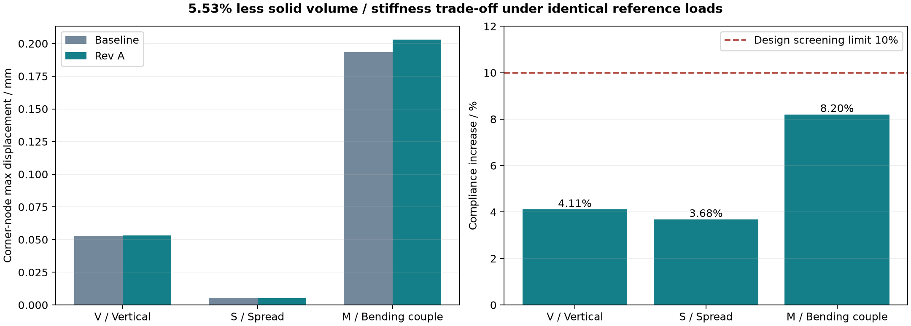

# OpenHand T42 支承顶板轻量化与刚度校核

基于 Yale OpenHand T42 的**独立机械设计与数值验证项目**。研究对象为手指支承顶板，保留原有安装接口，比较中央凹槽深度与变形代价。与四自由度机械臂项目分开维护。



## 已完成的结果

- 三种凹槽深度方案、有效 STEP/STL、参数化生成脚本及改制尺寸图。
- 候选方案：四个 10 × 24 mm、R2、深 1.8 mm 的凹槽，中央名义底厚 1.2 mm。
- 实体体积 **减少 5.53%**；统一密度 1.20 g/cm³ 下，全实体估算质量从 36.930 g 到 34.886 g。这不是实际打印重量。
- 最终三个参考载荷工况的最大柔度增加 **8.20%**；两档网格的柔度变化不超过 **0.66%**。
- 独立梁算例细网格挠度与含剪切的梁公式相差 **1.93%**。



| 工况 | 原始角点最大位移 / mm | 改型角点最大位移 / mm | 柔度增加 |
|---|---:|---:|---:|
| vertical_20N | 0.05276 | 0.05316 | 4.11% |
| spread_10N_each | 0.00535 | 0.00525 | 3.68% |
| opposed_500Nmm | 0.19334 | 0.20310 | 8.20% |



## 交付文件

- [六页中文作品集](output/pdf/T42-结构设计作品集.pdf)
- [候选 STEP](cad/variants/pocket_1p8.step)、[候选 STL](cad/variants/pocket_1p8.stl)
- [改制尺寸图](assets/modification_drawing.svg)
- [设计与验证说明](docs/设计与验证说明.md)
- [结果摘要](results/summary.json)、[对照 CSV](results/comparison.csv)
- [简历与证据](docs/简历与证据.md)

## 模型假设

均质各向同性线弹性材料，E=2000 MPa、ν=0.35；安装孔壁全固定；实际座面上分布载荷。三种工况是零件级参考，不是整手额定载荷。二次四面体位移单元在一阶直边几何上计算。柔度为 Fᵀu；应力输出是单元积分平均值，局部峰值不作强度结论。没有打样、耐久或抓取成功率实测。

实际工具为 CadQuery、Gmsh、scikit-fem 与 SciPy。STEP 可导入 SolidWorks / Workbench，但不附带其原生建模特征树，也不声称已在 Workbench 求解。

## 复现

Windows PowerShell，Python 3.12。环境、缓存和源文件默认放在 E 盘：

```powershell
./run.ps1 -Stage setup
./run.ps1 -Stage cad
./run.ps1 -Stage verify
./run.ps1 -Stage fea
./run.ps1 -Stage figures
```

全量依赖锁定见 requirements-lock.txt；直接运行依赖见 requirements.txt。报告脚本另依赖 reportlab。关键上游 STEP 已随仓库提供，不需要完整手模型即可复现；scripts/fetch_upstream.py 可获取固定版本的 188 个相关源文件并核验 Git blob 哈希，默认约 93 MB，放入 E:/Codex/downloads。

## 上游与许可

原始机构、顶板、手指及安装接口来自 [Yale OpenHand](https://github.com/grablab/openhand-hardware)，固定提交 b10197dcd79e7bcfa92c6d5a0bfa479e6a789fba。个人新增部分为四凹槽参数化改型、几何检查、数值模型、对照数据及文档。原始文件保留于 cad/upstream；派生文件位于 cad/variants。

The Yale OpenHand Project is an initiative to advance the design and use of robotic hands designed and built through rapid-prototyping techniques in order to encourage more variation and innovation in mechanical hardware. Please visit our site at www.eng.yale.edu/grablab/openhand for more details.

参考：R.R. Ma, L.U. Odhner, A.M. Dollar, “A Modular, Open-Source 3D Printed Underactuated Hand,” ICRA, 2013。上游与派生模型保留 CC BY-NC 3.0，见 [原许可](UPSTREAM_LICENSE.md) 和 [本仓库许可说明](LICENSE.md)。
