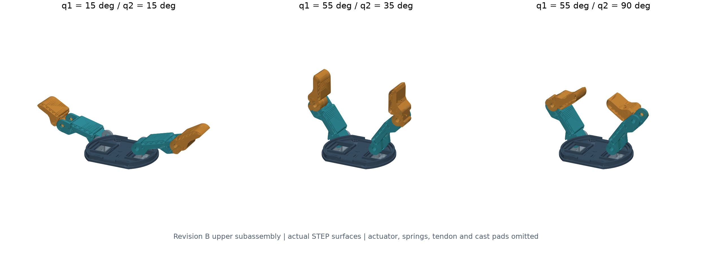
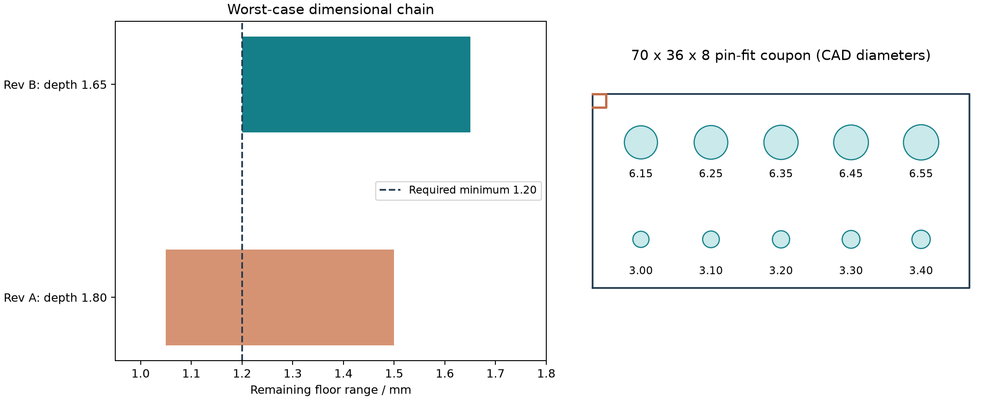
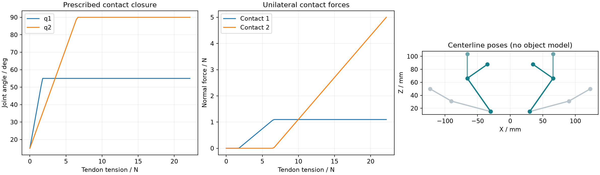
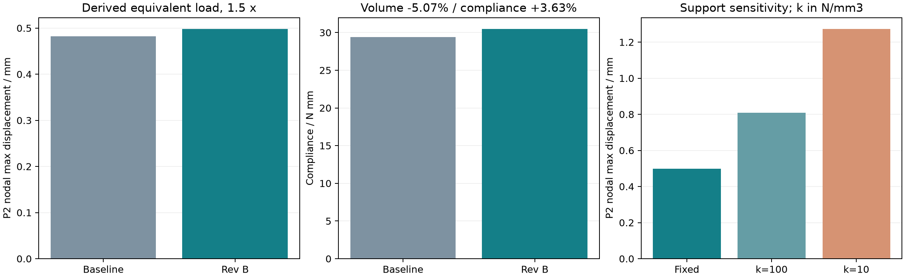

# 欠驱动夹爪结构分析与轻量化设计

基于 [Yale OpenHand T42](https://github.com/grablab/openhand-hardware) 双转轴方案的**独立二次设计项目**。当前为 **Rev B**：机构与传力计算、上部装配、关键配合与顶板改型、材料工艺规划、等效载荷有限元及试验方案。与四自由度机械臂项目分开维护。



## 已完成且有证据的工作

- 4 个关节几何自由度 / 2 个驱动的运动学和准静态传力模型，含非负接触筛查、驱动需求与 MX-28 候选核对。
- 修订顶板、支座及销孔成品尺寸，提供 STEP/STL、改制图、三类尺寸链与孔径试块；重建三姿态上部装配。
- 规定闭合路径 **39 个姿态、351 对零件** B-rep 求交检查，无实体相交。范围是上部刚体采样，不是整机连续扫掠。
- Rev B 顶板实体体积 **减少 5.07%**；新推导的等效载荷、刚性孔壁支承下柔度 **增加 3.63%**，两档网格柔度变化 **≤0.66%**。
- 弹性支承敏感性、销轴/耳板强度需求筛查、材料工艺路线和可填写的试验记录模板。

## 设计取舍

原 1.8 mm 深凹槽只有 1.2 mm **名义**底厚；考虑底板 ±0.15 mm 后，最不利仅 1.05 mm。Rev B 改为 1.65 mm 深，使拟定公差下的最小底厚达到 1.20 mm，因此体积收益从旧版 5.53% 调整为 5.07%。



## 成果入口

- [九页中文作品集](output/pdf/T42-结构设计作品集.pdf)
- [简历三点版与能力证据](docs/简历与证据.md)
- [机构与传力分析](docs/机构与传力分析.md)
- [装配、公差与工艺](docs/装配公差与工艺.md)
- [上部组件机械件清单](docs/机械件清单.md)
- [新增结构验证](docs/新增结构验证.md)
- [试验与验收计划](docs/试验与验收计划.md)、[空白记录模板](results/engineering/test_record_template.csv)
- [顶板 STEP](cad/engineering/top_plate_revB.step)、[支座 STEP](cad/engineering/bracket_revB.step)、[近指节 STEP](cad/engineering/finger_A_finished.step)、[远指节 STEP](cad/engineering/finger_B_finished.step)
- [闭合装配 STEP](cad/engineering/revB_upper_q55_90.step)、[孔径试块 STEP](cad/engineering/pin_fit_coupon.step)
- [顶板改制图](assets/revB_modification_drawing.svg)、[关节与支座检验图](assets/joint_inspection_drawing.svg)
- [计算摘要](results/engineering/summary.json)、[有限元原始数组](results/engineering/fea/raw-revB.zip)




## 适用边界

研究接触点、等效弹簧刚度、传动效率均显式列在 [engineering.json](engineering.json)，未冒充实测参数。计算将上部组件合力和合矩映射为顶板的等效牵引，未求解上下板实际接触分载。弹性支承刚度是敏感性输入；绝对位移不能当作已标定实物预测。局部应力峰值仍网格敏感，不给出强度安全系数或额定抓取力。

没有打样、称重、抓取成功率或耐久实测。孔与槽公差是拟定验收目标，成品 CAD 必须配合工艺试块和后加工方案使用。当前图纸为设计评审版。六类能力的完成程度及限制见简历证据表。

## 复现

实际工具：CadQuery/OpenCascade、Gmsh、scikit-fem、SciPy、Python。PDF 另用 ReportLab。未声称使用 SolidWorks/Workbench 求解；STEP 可导入，但没有相应原生特征树或工程文件。

Windows PowerShell；环境、缓存与下载默认使用 E 盘：

```powershell
./run.ps1 -Stage setup
./run.ps1 -Stage engineering
./run.ps1 -Stage engineering-fea
./run.ps1 -Stage engineering-report -ReportPython 'your-python-with-reportlab.exe'
```

`engineering` 生成几何、机构计算、Rev B CAD、碰撞检查与图；`engineering-fea` 运行六个新有限元算例并汇总；报告读取已有结果，**不重新求解**。计算顺序与软件依赖详见脚本及 requirements 文件。全部 FE 算例在普通电脑上可能需要较长时间。也可直接运行单个 Python 脚本。

## 版本与来源

Rev A 的 `design.json`、`cad/variants`、`results/summary.json` 和 [初版说明](docs/设计与验证说明.md) 保留为历史。**现行结果在 `results/engineering`，新模型在 `cad/engineering`**；两版载荷、材料和槽深不同，不混用百分比或位移。

原机构、指节、支座与基准顶板来自 Yale OpenHand，固定提交 `b10197dcd79e7bcfa92c6d5a0bfa479e6a789fba`。本项目新增参数化改型、成品配合修订、运动与静力模型、数值验证及文档。原始 STEP 保留于 `cad/upstream`；引用清单见 [工程来源](docs/工程来源.md)。

The Yale OpenHand Project is an initiative to advance the design and use of robotic hands designed and built through rapid-prototyping techniques in order to encourage more variation and innovation in mechanical hardware. Please visit our site at www.eng.yale.edu/grablab/openhand for more details.

R.R. Ma, L.U. Odhner, A.M. Dollar, “A Modular, Open-Source 3D Printed Underactuated Hand,” ICRA, 2013。上游及派生 CAD 遵循 CC BY-NC 3.0，见 [原许可](UPSTREAM_LICENSE.md) 和 [本仓库许可说明](LICENSE.md)。
